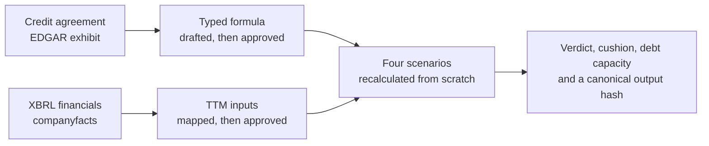
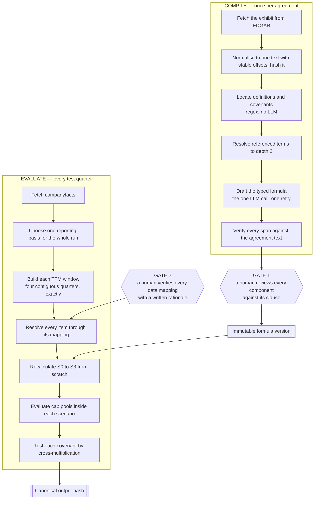
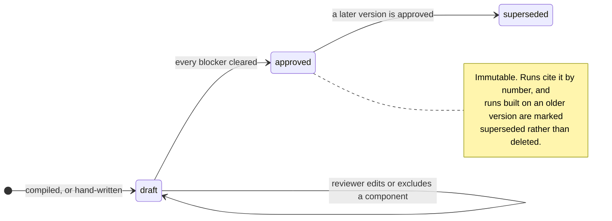
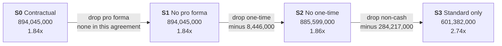
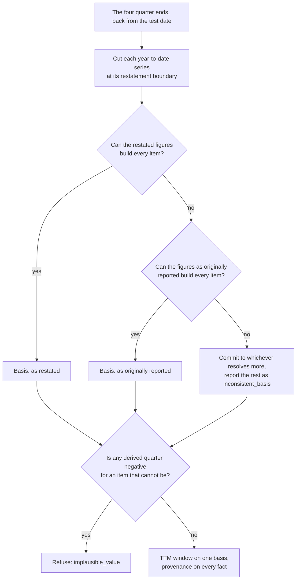
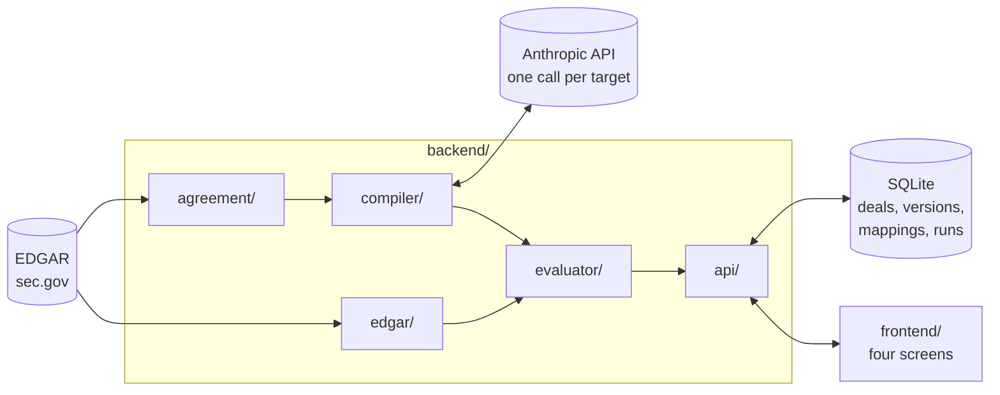

# Headroom

**A covenant sensitivity engine for private credit.** It shows how much of a
borrower's covenant cushion depends on the add-backs its credit agreement
allows, by recalculating every covenant under alternative EBITDA assumptions.

An LLM is used for exactly one thing: drafting a typed formula from clause
text. A human reviews every component against its clause and approves an
immutable formula version, and approves every financial data mapping. After
those two gates, everything is deterministic arithmetic with a full audit
trail.



---

## Contents

- [What it found on the golden deal](#what-it-found-on-the-golden-deal)
- [Running it](#running-it)
- [How it works](#how-it-works)
- [The scenario ladder](#the-scenario-ladder)
- [One basis per window](#one-basis-per-window)
- [How it is kept honest](#how-it-is-kept-honest)
- [Screens](#screens)
- [Results](#results)
- [Layout](#layout)
- [What this does not claim](#what-this-does-not-claim)

---

## What it found on the golden deal

Teleflex Incorporated, TTM to 29 June 2025, against its Third Amended and
Restated Credit Agreement. Every figure is built from the filings **as
originally reported** — see [One basis per window](#one-basis-per-window).

| Scenario | Covenant EBITDA | Leverage | Cushion | Coverage | Verdict |
| --- | ---: | ---: | ---: | ---: | --- |
| **S0** Contractual | 894,045,000 | 1.84x | 59.0% | 11.18x | PASS |
| **S1** No pro forma | 894,045,000 | 1.84x | 59.0% | 11.18x | PASS |
| **S2** No one-time | 885,599,000 | 1.86x | 58.6% | 11.08x | PASS |
| **S3** Standard adjustments only | 601,382,000 | 2.74x | 39.1% | 7.52x | PASS |

The covenant caps net leverage at 4.50x; net debt at the test date is
1,647,948,000. On the agreement's own terms the borrower is comfortable, with
59% of cushion.

> **32.7% of that covenant EBITDA comes from discretionary adjustments** —
> mostly a $240m non-cash goodwill impairment added back under the "any
> non-cash charges" clause. Strip every discretionary add-back and leverage
> rises by nine tenths of a turn, to 2.74x, and a third of the cushion is gone.

That gap is the entire point of the tool. Nothing about the business changed
between the first row and the last. On this quarter the borrower passes either
way, so the sensitivity is the finding rather than the verdict: a lender
holding this agreement is insured against a 2.74x borrower, not a 1.84x one.

---

## Running it

Needs Python 3.11+ and Node 20+.

```bash
make install     # virtualenv, Python deps, npm deps
make test        # the full suite
make demo        # load the golden deal through both gates and run its quarter
```

`make demo` works offline from the committed golden fixtures. `make demo-live`
fetches the agreement and the financials from EDGAR instead, and fails loudly
if the agreement text no longer hashes to what the approved formula was written
against.

Then, in two terminals:

```bash
make api         # http://127.0.0.1:8000  (and /docs for the typed API)
make ui          # http://localhost:5173
```

Drafting a formula with the LLM needs Anthropic credentials
(`ANTHROPIC_API_KEY`, or `ant auth login`). Everything else — the golden deal,
the runs, all four screens — works without them.

<details>
<summary><b>Every make target</b></summary>

| Target | What it does |
| --- | --- |
| `make install` | Virtualenv, Python deps, npm deps |
| `make test` | The full test suite |
| `make demo` | Seed and run the golden deal offline |
| `make demo-live` | The same, fetching from EDGAR |
| `make api` / `make ui` | Backend on :8000, frontend on :5173 |
| `make golden` | Rebuild the hand-written golden formula from the agreement |
| `make inputs` | Rebuild `ttm_inputs.json` from the committed companyfacts |
| `make hand-calc` | Recompute `expected.json` independently of the evaluator |
| `make verify` | Recheck the golden case with no `backend` imports at all |
| `make fixture` | Trim a live companyfacts response into the test fixture |
| `make measure` | Score the compiler against the golden formula (needs credentials) |

</details>

---

## How it works

Two loops. The compile loop runs once per agreement and ends at an approved
formula version; the evaluate loop runs every test quarter and needs nothing
from the LLM, which is why a rerun is cheap, repeatable and checkable.



The approved formula version is the only thing that crosses from the compile
loop to the evaluate loop.

### The two gates

Nothing computes until both gates are cleared, and neither can be bypassed by
reaching for a different API route — the rules live in the service layer, not
in the routes.



Approval is refused while anything is unresolved: an item outside the
vocabulary, a construct the language cannot express, an unreviewed component or
covenant, two components resolving to the same item, two items mapped to the
same reported concept, or a referenced definition nobody can find.

---

## The scenario ladder

Each scenario keeps fewer categories of add-back. Every one is recalculated
from the base term up, never by subtracting from the one before.



| Scenario | Keeps | Answers |
| --- | --- | --- |
| S0 | everything the agreement permits | What does the contract say? |
| S1 | standard, non-cash, one-time | What if projected savings never arrive? |
| S2 | standard, non-cash | What if the one-time charges recur? |
| S3 | standard only | What does the business actually earn? |

S0 and S1 are identical here because this agreement permits no pro forma
add-back: there are no projected cost savings to remove. The ladder still
works; its first step is simply empty, and the UI says so.

**Why recalculating matters.** If a pool capped at 20 holds restructuring of 15
and projected savings of 15, S0 allows 20 and S1 allows the full 15 — not 5.
Subtracting the removed item from S0 would be wrong by 10.

---

## One basis per window

Teleflex restated 2024 and 2025 when it separated its business. A filer that
restates rarely republishes every period the restatement affected, so taking
the most recently filed figure for each period independently mixes two
presentations inside one trailing twelve month window — and a quarter derived
across that seam is a subtraction of two numbers that were never measured the
same way. For this deal it produced a fourth quarter of 2024 with **negative
depreciation**, inside a TTM total that looked entirely ordinary.



For the golden deal the restated figures cannot produce the window: the
restating 10-K reissued the 2024 full year but never reissued the nine months
to 29 September 2024, so the fourth quarter has nothing to be derived from. The
run uses the figures as originally reported, says so on the deal screen and in
the audit trail, and carries the basis into the output hash — two runs that
chose differently are not the same measurement.

Whether the covenant's Consolidated EBITDA should be measured on continuing
operations or on the company as it was reported is a question about the
contract, and `docs/decisions.md` records that it is **unresolved**. What the
build guarantees is that whichever reading is right, the window is internally
consistent and names its basis.

---

## How it is kept honest

**Fail closed.** A missing input is never a zero. Each one carries a reason
code, reported per component and per scenario, so the analyst sees which fact
is missing and which results it affects.

| Reason code | Meaning |
| --- | --- |
| `missing_quarter` | One of the four TTM quarters is neither reported nor derivable |
| `missing_instant` | No balance fact is dated at the test date |
| `incompatible_facts` | Facts exist but cannot be combined |
| `ambiguous_mapping` | A required item's mapping is still `review_required` |
| `missing_analyst_input` | An item needs an analyst value and has none for this period |
| `unsupported_adjustment` | A scenario includes a clause the reviewer excluded as unsupported |
| `unapproved_formula` | No approved formula version exists for the deal |
| `inconsistent_basis` | The window would have to mix restated and originally reported figures |
| `implausible_value` | A derived quarter produced a value the item cannot take |

**Exact arithmetic.** Every amount is a `Decimal` parsed from a string; floats
are rejected at the schema boundary. Verdicts are decided by cross
multiplication (`D ≤ T × E`), never by comparing a rounded ratio, so a borrower
exactly at the threshold is never reported as a breach because of a division
remainder.

**Arithmetic impossibilities refused.** A derived quarter is a subtraction of
two cumulative figures, which is where a basis error surfaces as something the
item cannot be: depreciation does not run backwards and a lender does not pay
the borrower interest. A negative derived quarter for such an item is refused
rather than summed into a plausible-looking total. A negative quarter the filer
actually *reported* is kept — that is the filer's statement.

**Span verification.** A drafted span is rejected unless the agreement text at
its offsets equals the quote. That proves the text exists. It does *not* prove
the clause was read correctly — that is what the component-level review and the
measured semantic accuracy are for.

**Analyst values are bound to a period and a basis.** A figure a human
hand-summed is refused for another quarter (`missing_analyst_input`) and
refused on a run built from the other vintage of the filer's figures
(`inconsistent_basis`). The one-basis rule is not weaker for a number a person
typed in than for one the pipeline selected.

**Reproducibility.** A run stores the formula version, source hash, reporting
basis, mapping versions, evaluator version, every fact's accession number, each
pool's working, and a canonical output hash over sorted-key JSON with decimals
as strings. The same inputs and versions always produce the same hash.

---

## Screens

| Screen | Question | What it shows |
| --- | --- | --- |
| **Deal** | How much protection does the lender have? | The finding in a sentence, the four scenarios per covenant, debt capacity, the reporting basis |
| **Formula review** | Does the formula match the contract? | Agreement text beside the formula, clause highlighted on selection, per-component review, the mapping table |
| **Stress testing** | How much rests on adjustments? | Adjustment dependence, the scenario ladder with the components behind each fall, per-scenario component states |
| **Audit trail** | Can I verify this myself? | Every input with its accession numbers, cap pool workings, mapping rationales, source clauses, versions and the output hash |

Clicking any figure opens its working, down to the filing it came from.

---

## Results

| Metric | Target | Result |
| --- | --- | --- |
| Scenario consistency | 100% | All four scenarios and both covenants match `scripts/hand_calc.py`, a second implementation that never imports the evaluator |
| Independent verification | 0 differences | `scripts/verify_teleflex.py` imports nothing from `backend` and re-derives every figure from the raw companyfacts JSON using only the standard library |
| Determinism | 100% | One hash across 10 identical runs, across three decimal precisions in three threads, and across a fresh database |
| Span fidelity | 0 fabricated spans accepted | Fabricated quotes, drifted offsets and out-of-range spans are all rejected |
| Fail-closed | 100% | Each removed fact produces its correct reason code; no scenario falls back to zero |
| Mapping coverage | Reported | 12 of 12 required items verified, of which 9 from reported concepts and 3 from sourced analyst values |
| Reporting basis | Single basis per run | Every fact in the golden window carries one basis, no derived quarter is negative, and the snapshot rebuilds from the committed companyfacts |
| Compiler semantic accuracy | Reported, **not yet measured** | `make measure RUNS=5` compiles each golden agreement five times and scores every clause on item, sign, category and cap rule, with run-to-run stability. It needs Anthropic credentials, so it is not part of the test suite, and no figure is claimed until it has run — see [`docs/evaluation/compiler.md`](docs/evaluation/compiler.md) |

The suite is **200 tests** covering the arithmetic, the cap engine, XBRL
handling, the reporting basis, the compiler, the API and the golden deal end to
end, including Hypothesis property tests for three evaluator invariants:
removing a positive add-back never raises the cushion, a pool's allowance never
exceeds its cap, and results never depend on the order components are listed
in. One further test fetches from EDGAR and is skipped unless
`HEADROOM_LIVE=1`.

Three implementations agree on every figure in the golden table: the evaluator,
the longhand hand calculation, and the standard-library verification script.

### What it looks like when it cannot answer

Run the same deal at 31 December 2025 and all four scenarios decline, each
naming the item that stopped it.

Teleflex tags impairment only in the quarters where the amount is non-zero, so
no TTM window can be built mechanically, and the analyst values that filled the
gap were sourced for the period ending 29 June 2025. S0, S1 and S2 report
`missing_analyst_input` naming both dates rather than reusing a stale figure.
S3 needs only the standard adjustments, but at this date depreciation can only
be derived as the restated full year minus the originally reported nine months,
which comes to a quarter of −33,230,000 — not a small number, but the signature
of two figures that were never measured the same way. It is refused as
`implausible_value`, and the covenant is reported NOT_COMPUTABLE with no ratio.

An earlier version answered this quarter with a confident BREACH built on that
impossible quarter. Declining is the better answer.

---

## Layout

```
backend/
  agreement/   fetch, normalise to text with stable offsets, locate sections,
               definitions graph
  edgar/       EDGAR client with cache and throttle, XBRL facts with
               provenance, reporting basis, TTM builder, mapping records
  compiler/    draft request, closed JSON schema, span verifier, accuracy scorer
  evaluator/   formula language, cap engine, scenarios, covenant maths, verdicts
  api/         FastAPI routes, SQLite storage, the two gates
  mapping.yaml candidate concepts per formula item
frontend/      React + TypeScript, four screens
data/golden/   one agreement: the hand-written formula, verified mappings with
               rationales, the TTM inputs with accession numbers, and the
               expected result for every scenario
docs/          decisions.md, and a verification worksheet per golden deal
scripts/       golden formula builder, input snapshot builder, independent
               hand calculation, independent end-to-end verification, demo
               seed, compiler measurement
```



---

## What this does not claim

The figures are an analyst's estimate built from public filings, not the
borrower's official compliance numbers. The scenarios show sensitivity to the
adjustments the agreement permits, not "true" earnings. Debt capacity is under
the one covenant it is shown against; other covenants, debt baskets and
borrowing conditions may still restrict new debt. None of it is investment
advice or a credit rating.

`docs/decisions.md` records every place the implementation departs from the
spec and why, every finding that changed the output, and the known limitations
of the golden deal's mappings. `docs/verification/teleflex.md` is the
fact-by-fact worksheet for the golden case.

---

## Sources

- [SEC — EDGAR APIs](https://www.sec.gov/search-filings/edgar-application-programming-interfaces)
- [SEC — EDGAR full-text search](https://www.sec.gov/edgar/search/)
- [St. Louis Fed — EBITDA add-backs in debt contracting](https://fedinprint.org/item/fedlwp/94811/original)
- The golden agreement: Teleflex Incorporated, EX-10.1 to the 8-K filed
  30 June 2025, accession `0000096943-25-000107`
